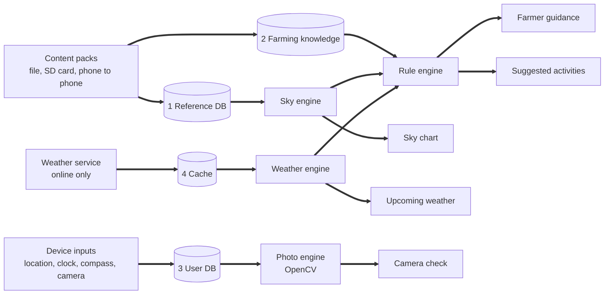

# StarCrop

**An offline first sky and weather app for farmers.**

StarCrop identifies constellations and stars, shows the upcoming weather, and turns both into practical farming guidance for when to plant, spray, or harvest. Everything works without internet. Only the weather download needs signal, and the last forecast is kept on the phone.

**Status:** app is built. Additional data is needed for local sky culture.

***

## Features

* **Constellation and star identification.** See what is overhead, including local sky cultures and names in local language.
* **Upcoming weather.** The forecast is downloaded when a signal is available and cached for offline use.
* **Farmer weather guidance.** Rules that combine the sky and the forecast into plain language advice.
* **Activity suggestions.** Plant, spray, harvest, or prepare, based on the rules that match today's sky and weather.
* **Camera confirmation.** Take a photo of the night sky to confirm the constellation and correct the phone's compass.

## Design principles

1. **Offline first.** No feature except the forecast download requires a connection.
2. **Every rule has a source.** Each farming rule cites a farmer, extension office, or publication, and shows a verification status: `draft`, then `reviewed`, then `confirmed`.
3. **Compute, don't store.** Altitude and azimuth, rise and set times, moon phase, and sun position are calculated on the fly. Only the results are cached.
4. **Reference data is replaceable.** Content packs swap out reference and farming data without touching the user's own data.
5. **Ready for sync.** Every user data row carries a UUID plus `created_at`, `updated_at`, and `deleted`, so optional cloud sync stays possible later.

***

## Architecture

### The four databases

**1. Reference database.** Shipped with the app, read only, replaced by content packs.

* `stars`
* `constellations`
* `constellation_lines`
* `constellation_names`
* `sky_cultures`
* `timezones`
* `places`

**2. Farming knowledge.** Curated by the team, read only.

* `farming_rules` (the hub)
* `sky_triggers`
* `weather_triggers`
* `activities`
* `crops`
* `regions`
* `sources`

**3. User database.** On the device, writable.

* `saved_locations`
* `weather_log`
* `farm_log`
* `photo_observations`
* `photo_results`
* `device_profiles`
* `feedback`
* `user_settings`

**4. Cache.** Disposable, safe to delete and rebuild.

* `weather_forecast_cache`
* `visibility_cache`
* `sky_snapshot`

### The engines

* **Sky engine.** Location and clock in, what is overhead out: constellations, stars, moon phase.
* **Rule engine.** Matches today's sky and forecast to farming rules, outputs guidance and suggested activities, and shows each rule's verification status.
* **Weather engine.** Refreshes the forecast whenever online. Offline, it falls back to the last forecast and `weather_log`, and shows the forecast age ("may be outdated").
* **Photo engine (OpenCV).** Finds stars in a photo, compares them to the predicted sky, confirms the constellation, and fixes compass error. Writes `photo_results` and `device_profiles`.

### How farming rules fire

A rule can use a sky trigger, a weather trigger, or both (AND). At least one must be set.

* Sky triggers: `visible`, `first_rise`, `last_set`, `sun_longitude`, `moon_phase`, `date_range`
* Weather triggers: rain, temperature, wind, or humidity, with an operator, threshold, days ahead, and duration

### Cross database links

The databases link by ID only, not by enforced foreign keys.

* `saved_locations.place_id` points to `places.geoname_id`
* `farm_log.crop_id` points to `crops.crop_id`
* `farm_log.activity_id` points to `activities.activity_id`
* `feedback.rule_id` points to `farming_rules.rule_id`

**Never delete or renumber IDs** that the user database may point to. Content packs replace the reference and farming databases, so retire old IDs instead.

***

## Content packs

Star, place, and farming data is updated through content packs, delivered by file, SD card, or phone to phone transfer. Packs are versioned and checksummed, and they replace reference data only. User data is never touched.

## Schema documentation

* [`docs/schema.md`](docs/schema.md) has the full Mermaid ER diagrams and renders on GitHub
* [`docs/schema.dbml`](docs/schema.dbml) is the DBML version for dbdiagram.io

Update the schema docs in the same commit as any database migration.
