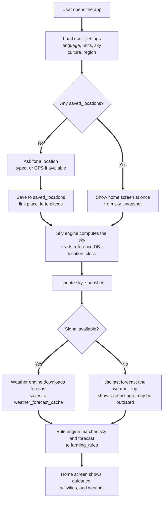
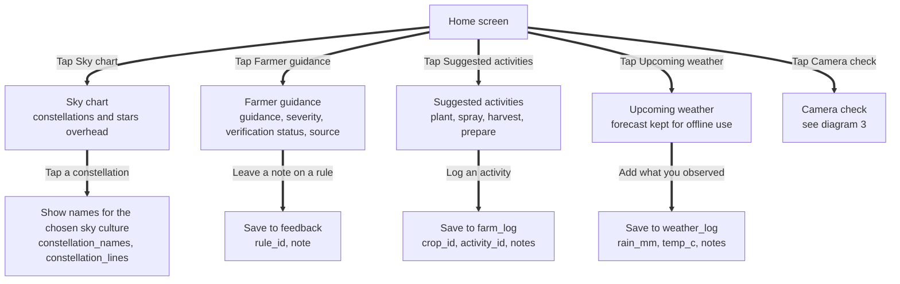
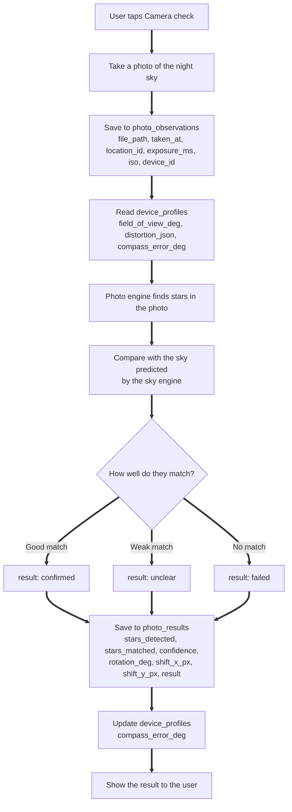
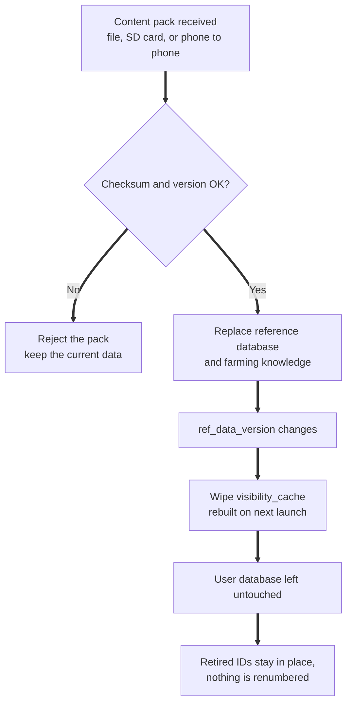

# App Flow (Mermaid)

Split into four diagrams so each stays readable on GitHub. Table names in the boxes show what each step reads or writes, so this file lines up with `schema.md`.

## 1. App launch

What happens from the moment the user opens the app.

## 2. Screens

What the user can open from the home screen and what each one does.

## 3. Camera check

The photo engine flow, from taking the photo to correcting the compass.

## 4. Content pack update

How new star, place, and farming data arrives without touching user data.

## Notes on what comes from where

* Diagram 1 follows the drawio and `schema.md`: typed location or GPS, the instant home screen from `sky_snapshot`, and the online versus offline weather behaviour.
* The five screens in diagram 2 come from the drawio. The taps that lead to `feedback`, `farm_log`, and `weather_log` are inferred from those tables, because the drawio has no arrow from a screen to them. Confirm or remove them.
* Diagram 3 follows the photo engine box. The three result values come from `photo_results.result` in `schema.md`.
* Diagram 4 follows the content pack box and the ID rule at the bottom of `schema.md`. The step that rejects a bad pack is inferred from "versioned and checksummed".
* The drawio has no screen for `user_settings`, so settings are only loaded here and never edited.
