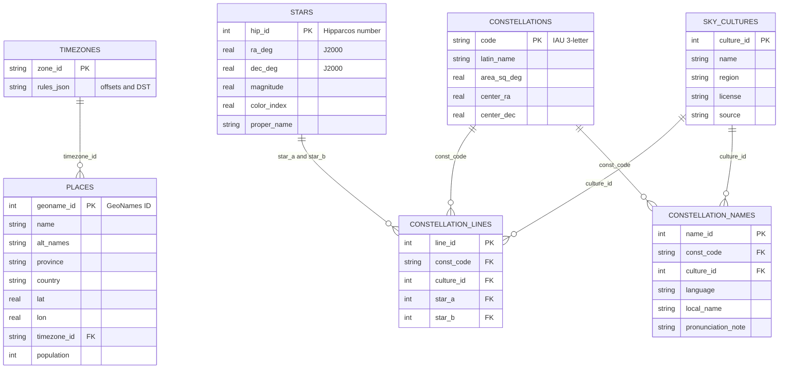
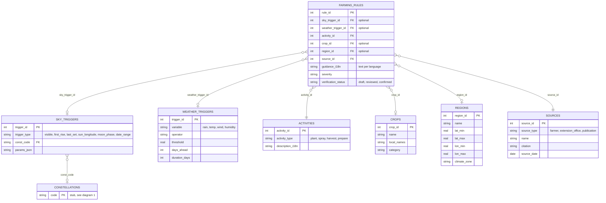
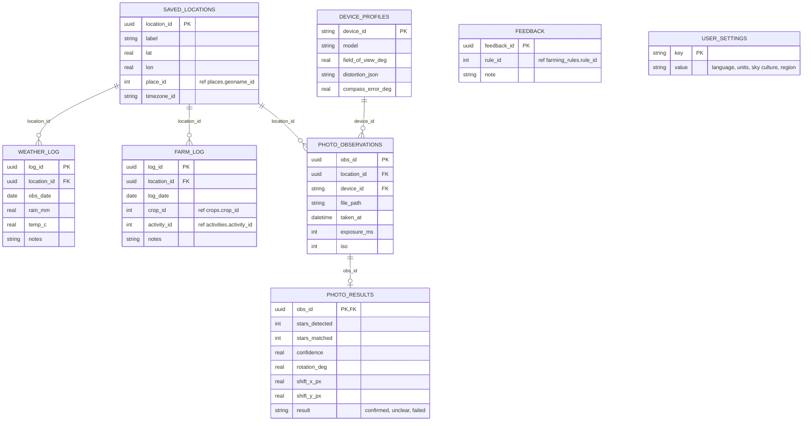
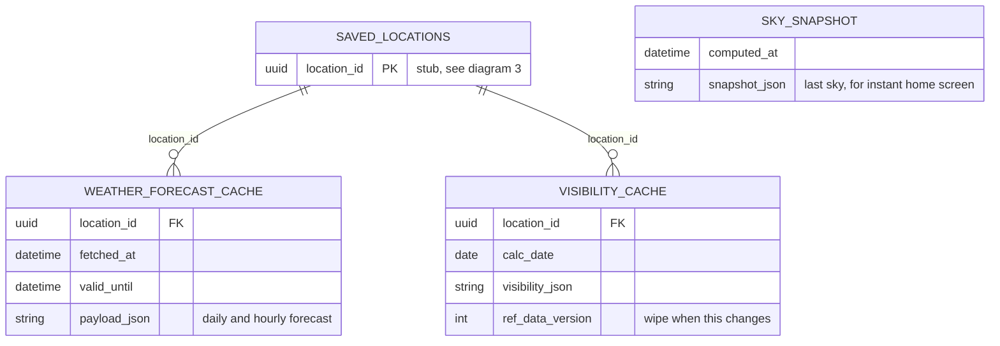

# Data Schema (Mermaid)

Split into four diagrams so each stays readable on GitHub. Edit this file in the same commit as any database migration.

Cross-database links are by ID only (see the table at the bottom). Tables from another database appear here as small stubs.

## 1. Reference database (shipped, read-only)

Not stored, computed on the fly: altitude/azimuth, rise and set times, moon phase, sun position.

## 2. Farming knowledge (curated, read-only)

A rule may use a sky trigger, a weather trigger, or both (AND). At least one must be set.

## 3. User database (on device, writable)

Every table also carries `created_at`, `updated_at`, and `deleted` (omitted below for space). This keeps optional cloud sync possible later.

## 4. Cache (disposable, safe to delete and rebuild)

## Cross-database links (by ID, not enforced by foreign keys)

| From (user DB) | To (reference or farming DB) |
|---|---|
| `saved_locations.place_id` | `places.geoname_id` |
| `farm_log.crop_id` | `crops.crop_id` |
| `farm_log.activity_id` | `activities.activity_id` |
| `feedback.rule_id` | `farming_rules.rule_id` |

Because content packs replace the reference and farming databases, never delete or renumber IDs that the user database may point to. Retire them instead.
